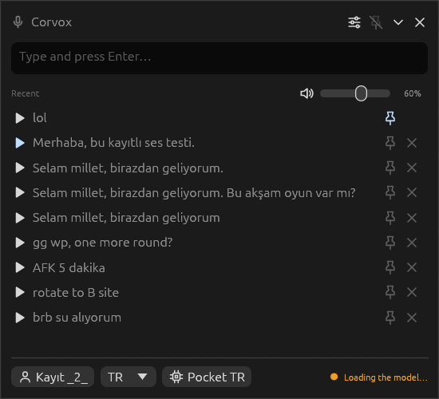
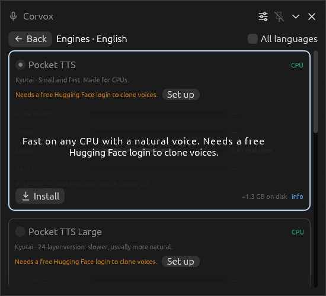

# Corvox

Type a line, hear it in **your own voice** in Discord (or any app with a mic setting).

<p align="center"> </p>
<p align="center"></p>

Corvox copies your voice from a short clip (10–20 seconds, any audio file) and speaks whatever you type into a virtual microphone. Discord just sees a mic. No bot, no Discord tokens, and your text and voice never leave your PC (only the models are downloaded).

- Small native window (Rust + egui), collapses into a one-line bar (drag it from anywhere)
- A global shortcut brings Corvox up; press it again to go back to the window you were in
- Recent and pinned phrases: click one, or use ↑/↓, to say it again. Their audio is saved, so they replay instantly without the engine (can be turned off, and you choose how many to keep)
- Engines install and download in the background with Pause/Resume, while the current one keeps working; a chime plays when one is ready
- Delete an engine's packages and model (including half-finished downloads) from its card; clear uv's download cache in Settings
- English or Turkish interface
- Pick a language, then any engine that speaks it. CPU engines work on any PC; GPU engines are optional
- "Test on my PC" measures each engine with your voice: **voice match**, **clarity**, **speed**, **RAM/VRAM**
- Can hold your push-to-talk key while it speaks

## Engines

| Engine | Languages | Runs on | License |
|---|---|---|---|
| [Pocket TTS](https://github.com/kyutai-labs/pocket-tts) (Kyutai) | English, French, German, Portuguese, Italian, Spanish, Dutch | CPU | MIT code, see model page |
| Pocket TTS Large (Kyutai, 24-layer) | same as above | CPU (slower) | same |
| [Pocket TTS Turkish](https://huggingface.co/kaanhgunay/pocket-tts-tr) (community v0.1) | Turkish | CPU | CC BY 4.0 |
| [XTTS-v2](https://github.com/idiap/coqui-ai-TTS) | 17 incl. Turkish | NVIDIA GPU (slow on CPU) | Coqui Public Model License, **non-commercial** |
| [Chatterbox Multilingual](https://github.com/resemble-ai/chatterbox) | 23 incl. Turkish | NVIDIA GPU | MIT |

Kyutai's Pocket TTS models only clone voices after you **accept their terms on Hugging Face** (free, instant): accept at [kyutai/pocket-tts](https://huggingface.co/kyutai/pocket-tts), [create a read token](https://huggingface.co/settings/tokens), paste it in Settings. The Turkish model doesn't need this.

Example numbers, Turkish, with a real 20 s phone recording as the voice (Ryzen 7 5800H laptop, RTX 3060 6 GB):

| Engine | Runs on | Speed | Memory | Voice match | Clarity |
|---|---|---|---|---|---|
| Pocket TTS Turkish (int8) | CPU | 0.99× real time | 1.5 GB RAM | 79% | 95% |
| XTTS-v2 | GPU | 1.74× real time | 2.0 GB VRAM + 1.8 GB RAM | 85% | 100% |
| Chatterbox Multilingual | GPU | 0.19× real time | 3.9 GB VRAM + 2.4 GB RAM | 89% | 85% |

Chatterbox is the best voice match but very slow on a laptop RTX 3060: about 26 seconds for 5 seconds of speech.

int8 makes the Pocket engines about 10% faster and saves about 450 MB of RAM at the same quality; it's on by default and can be turned off in Settings.

Speech is streamed: the first audio plays about half a second after you press Enter, and generation keeps pace with playback. Stop (or Esc) cancels instantly. Run "Test on my PC" for your own numbers.

Engines are installed from inside the app, with a progress bar for each step: Python packages first, then the model download. Each engine family lives in its own Python environment managed by [uv](https://docs.astral.sh/uv/), so you never install Python yourself. On disk: the Pocket engines share about 0.9 GB plus 0.4–1.2 GB per model; XTTS-v2 is about 9 GB and Chatterbox about 10 GB (mostly CUDA PyTorch).

## Setup

### 1. Install uv

- Windows: `winget install astral-sh.uv`
- macOS / Linux: `curl -LsSf https://astral.sh/uv/install.sh | sh`

### 2. Virtual microphone

Discord needs a microphone to hear Corvox, so Corvox plays into a *virtual audio cable* and Discord listens to the other end. Click **Set up** (main window) or **Set up virtual mic** (Settings):

| OS | What happens | Then in Discord, set Input Device to |
|---|---|---|
| Windows | Corvox downloads [VB-Cable](https://vb-audio.com/Cable/) (free, by VB-Audio) from vb-audio.com, checks the installer is signed by VB-Audio, and opens it. Approve the Windows prompt and click **Install Driver**. A restart may be needed. | `CABLE Output` |
| macOS | Opens the [BlackHole](https://existential.audio/blackhole/) download page; install BlackHole 2ch. | `BlackHole 2ch` |
| Linux (PipeWire/PulseAudio) | Corvox creates the mic itself with `pactl`, no install. | `Corvox Mic` |

Doing it by hand on Linux:

```bash
pactl load-module module-null-sink sink_name=corvox sink_properties=device.description=Corvox
pactl load-module module-remap-source master=corvox.monitor source_name=corvox_mic source_properties=device.description="Corvox Mic"
```

Corvox picks the cable automatically. You can change it in Settings.

### 3. Get Corvox

Download a release, or build it:

```bash
git clone <this repo> && cd <repo>/app
cargo build --release
```

Keep the `engines/` folder next to the app (or set `CORVOX_ENGINES` to its path). On Windows, build from PowerShell or cmd (Git Bash's `link` command shadows the MSVC linker).

### 4. First run

1. **Voice** button: pick an MP3/WAV/M4A of you talking for 10–20 s, no music or noise.
2. **Engine** button: pick your language, install an engine, select it.
3. Type, press Enter.

About the clip: longer isn't better. With Pocket TTS Turkish, a 5–10 s clip matched the voice best (78–81%); 14 s and 19 s clips scored 74% and 68% and used more RAM. Corvox uses up to 10 s.

Cloning models also continue from the end of the clip, so Corvox feeds them the part of your recording that ends at a natural pause (up to 10 s) plus a little silence. With a clip that ended mid-word, the Turkish model invented extra words before reading the text (clarity 14%); cut at a pause, clarity was 95%. Pausing briefly at the end of your recording helps.

## Discord tips

- Turn off Discord's **noise suppression** (Krisp) for the Corvox mic; it can garble synthetic speech.
- **Push to talk**: in Discord set a PTT key you never press (F13–F24 are perfect, they exist but no keyboard has them), then choose the same key in Corvox's Settings. Corvox holds it while speaking.
- **Voice activity**: works too, set the sensitivity so silence doesn't trigger it.
- Want to talk *and* type? Use VoiceMeeter (Windows) or a PipeWire loopback to mix your real mic with the cable.

## Development

```bash
cd app
cargo run                      # debug build
cargo test                     # audio import tests
```

Debug switches (environment variables):

- `CORVOX_HOME=<dir>`: use a separate settings, voices and saved-phrase folder
- `CORVOX_ENVS=<dir>`: use a separate folder for engine environments
- `CORVOX_ENGINES=<dir>`: where `engines/` is
- `CORVOX_SAY="text"`: speak this on startup
- `CORVOX_SHOT=out.png` (+ `CORVOX_SHOT_PAGE=engines|voices|settings`, `CORVOX_SHOT_AFTER=<secs>`): save a screenshot and quit
- `CORVOX_INSTALL=<env>`: start installing an engine environment on launch
- `CORVOX_OFFSCREEN=1`: open off-screen without taking focus (for screenshots)
- `CORVOX_THREADS=n`: CPU threads for Pocket engines (default 4)

Run the helper by hand: `cd engines/pocket && uv run python -m corvox_engine --bench --model pocket-tr --language tr --voice my.wav`

## How it works

```
┌──────────── Rust app (native) ────────────┐        ┌──── Python helper (uv) ────┐
│ window · hotkey · phrases · settings      │ stdin  │ loads the chosen model     │
│ voice clip import (any format → 24k WAV)  │ ─────► │ text → speech in your voice│
│ audio out → virtual cable (+ speakers)    │ ◄───── │ streamed in ~250 ms chunks │
│ push-to-talk key                          │ stdout │ "Test on my PC" benchmark  │
└───────────────────────────────────────────┘  JSON  └────────────────────────────┘
```

- `app/`: the Rust app.
- `engines/catalog.json`: engines, languages, published numbers. Add an engine here.
- `engines/core/`: the helper (`python -m corvox_engine`) and one adapter per model in `corvox_engine/adapters/`.
- `engines/<env>/pyproject.toml`: one uv environment per engine family (`pocket`, `xtts`, `chatterbox`).

Your settings, voices and engine environments live in your OS's app-data folder (shown in Settings).

### What "Test on my PC" measures

It runs in a fresh helper process with your selected voice and language:

- **Voice match**: cosine similarity between speaker embeddings ([WeSpeaker ResNet34](https://github.com/k2-fsa/sherpa-onnx)) of your clip and the output. 100% = identical; different people usually score under 30%.
- **Clarity**: Whisper (`base`) transcribes the output; 100% minus the character error rate.
- **Speed**: seconds of speech produced per second of compute. Above 1× means faster than real time.
- **RAM / VRAM**: peak memory of the helper while speaking, with the model loaded.

The first test downloads about 170 MB of checking models.

### Adding an engine

1. Write an adapter in `engines/core/corvox_engine/adapters/` with `load(language)` and `synth(text, voice_path, language) -> (float32 samples, sample_rate)`. Override `synth_stream` if the model can stream.
2. Register it in `registry.py`.
3. Add an entry to `engines/catalog.json` (and a new `engines/<env>/pyproject.toml` if it needs different packages).

## Please

Only clone voices of people who agreed to it. Don't use this to impersonate anyone.
